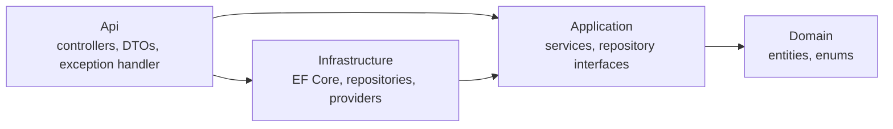
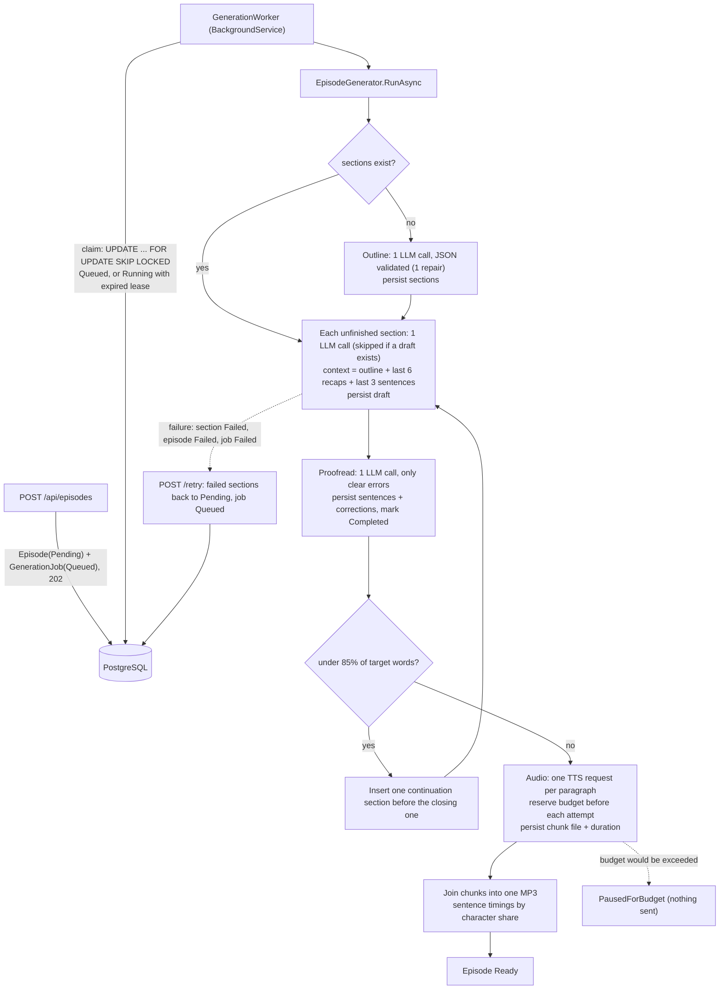
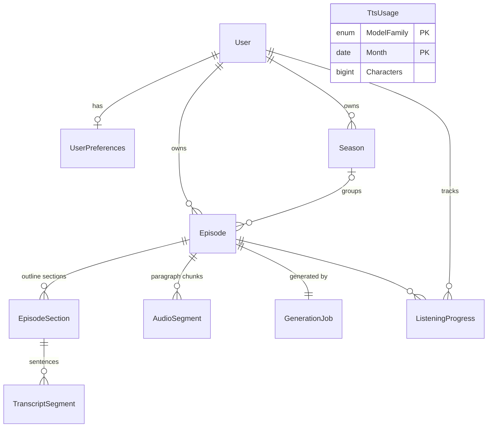

# Architecture

Decisions are in [DESIGN.md](DESIGN.md). This file explains how the code implements them and records the non-obvious choices.

## Layers

Controllers map entities to DTOs; entities never leave the API. Services throw `RequestValidationException` / `NotFoundException`, and `ConflictException`, which `AppExceptionHandler` turns into `ProblemDetails` (400 / 404 / 409). DataAnnotations on request DTOs catch malformed input; business rules (supported languages, configured duration range) live in services.

## Generation pipeline

- **Idempotent by construction.** `RunAsync` reloads the episode and only does what is missing. A section is saved and marked `Completed` in one `SaveChanges`, so a crash mid-call loses at most that call.
- **Leases.** A claimed job's `LockedUntil` is renewed every lease/3 while it runs. A failed renewal is logged and retried on the next tick. After a crash the lease expires and the next poll claims the job again. On graceful shutdown the worker hands the job back immediately. Every claim increments `Attempts`, and that number is the owner token: renewals, hand-backs and the final status update only apply while it still matches. A worker that lost its lease therefore stops and writes nothing, so two API instances never finish the same episode.
- **Proofreading.** Learners copy what they hear, so each section gets a second, low-temperature call that may only fix clear errors (gender, case, endings, spelling). The draft is saved before proofreading, so a proofreading failure never pays for the section text again. Replies that change the paragraph count or move any paragraph by more than 10% of its words are rejected (one repair, then the draft is kept and a warning logged, so an over-eager proofreader can't block an episode). The draft and the list of corrections stay in `EpisodeSection.DraftJson` / `CorrectionsJson` for auditing. On a real Gemini run it fixed exactly the two errors in a 526-word section and changed nothing else. Disable with `Episodes:Proofread=false`.
- **Audio chunks.** One TTS request per transcript paragraph (≤ 1,000 chars, well under Google's 5,000-byte request limit). Each `AudioSegment` has a cache key, `sha256(provider, model family, voice, speaking rate, text)`. Chunks with an unchanged key are never synthesized again, and a changed one is replaced. A finished chunk whose file has disappeared (storage moved or cleaned) goes back to Pending, so a retry can always finish. The resolved voice is stored on the episode at creation, so changing the configured default voice later doesn't invalidate finished audio.
- **Budget before every attempt.** The pipeline reserves the chunk's UTF-8 byte count in `TtsUsage` with one conditional `UPDATE ... WHERE Characters + n <= budget`, so concurrent reservations can't both pass. Only then is the request sent. The provider makes exactly one HTTP attempt per call; retries (transient 429/5xx/timeouts, up to 3 per run) happen in the pipeline and reserve again, so no request can bypass the budget. The family being charged is derived from the voice name, which is what Google bills by. Preferences must pair a voice with its own family, and the pipeline refuses a mismatched voice before reserving or sending anything. Budget months follow the provider's billing time zone (`Tts:BillingTimeZone`, Pacific time for Google), not UTC, so the counter doesn't reset hours before Google's does. A refused reservation pauses the episode (`PausedForBudget`), which is not a failure: retry once budget is available. Creating an episode whose estimate (`words × Tts:CharsPerWord`) doesn't fit the remaining budget is refused with 409 before any LLM call.
- **One stitched MP3.** Chunks are joined frame by frame by a small MPEG Layer III parser (`Mp3`), with no ffmpeg. ID3 tags and Xing/Info/VBRI header frames are dropped, otherwise players would take the first chunk's header as the length of the whole file. Durations come from counting frames. Sentence timings split each paragraph's measured duration by character share, which is close enough for highlighting and click-to-seek. One file keeps the player trivial: a single `<audio>` element with native seeking, speed and resume, served with HTTP Range support.
- **Auth by API key**, not a service account: plain REST with `X-Goog-Api-Key` (never in the URL, which ends up in logs) and no Google SDK or gRPC dependencies. The key should be restricted to the Text-to-Speech API.
- **Rolling context.** Each section call returns `{paragraphs, recap}`. The recap (English, 2–3 sentences) is the rolling summary for later sections, so there is no extra summarization call and the prompt size doesn't grow with episode length.
- **Length is measured.** Word counts come from the generated text. One continuation section is added if the episode is clearly short. It goes before the closing section so the goodbye stays last, and it is skipped for single-section episodes.
- **LLM errors.** 429 responses are retried with `Retry-After` or exponential backoff with jitter, behind a requests-per-minute limiter. 5xx responses and network errors use a longer base backoff (`Llm:OverloadBaseDelayMs`), because overload lasts minutes. Timeouts are retried only `Llm:MaxTimeoutRetries` times (default 1), since a timed-out request may still be billed against the free quota. A `Retry-After` longer than `Llm:MaxDelaySeconds` (daily quota) stops retrying at once. When the main model is unavailable after all that, the call is repeated once on `Llm:FallbackModel`; overload and free quotas are per model. 4xx configuration errors (bad key, unknown model) fail immediately and never fall back.
- **Speaking speed and length.** Level picks the language, speaking speed picks the pace, and both feed the length. The first real episode came out at 8.3 instead of 10 minutes, because WaveNet reads ~160 words/min and the old per-level estimate assumed 125. Now each voice family has a measured pace (`Tts:Pace`), and `speakingRate` scales it. WaveNet durations scale exactly with the rate (0.85× → 1.17× longer). Chirp 3: HD only scales by about two thirds as much (0.75× → 1.21× longer), so its pace has an exponent of 0.66. Speed is resolved once at creation (request, then preferences, then level default) and stored on the episode, so a retry voices the rest at the same speed. It is part of each chunk's cache key.
- **Length prompting.** Measured on Gemini, asking for "about N words" produced ~70% of N. Section prompts (`section.v2`) ask for a minimum word count *and* a paragraph count of ~100 words each, which brought sections to ~85%.

## Frontend
`web/` is React + TypeScript + Vite, with React Router and plain `fetch`. There's no state library, UI kit or icon package.
- `api/client.ts` is the only place that calls the API. It turns `ProblemDetails` into an `ApiError`, whose `fieldErrors` use the form's camelCase names, so validation messages show next to the right field.
- `useApi` loads data for a screen and cancels the previous request when inputs change. Every screen has loading, empty and error states.
- **Persistent player.** `PlayerProvider` owns the app's only `<audio>` element, above the router, so playback continues across pages and the mini-player can control it. It saves the resume position every 5 s while playing, on pause, at the end, and when the tab is hidden (with a `keepalive` request so it survives closing the tab).
- **Read-along.** Transcript sentences are inline spans with `role="button"`, not `<button>`s, because buttons render inline-block and would break the paragraph flow. A binary search over sentence start times finds the current sentence, and it's scrolled into view unless the listener turns that off.
- **Generation progress.** The episode page polls `/status` every 2.5 s while the episode is being made, and switches to the player when it's Ready.
- **Library filters live in the URL,** so reloads and back/forward keep them.
- **Design.** It's styled as a quiet device: warm-grey housing, ink, and one green signal colour. The transcript is the one loud element, in a book serif (Charter) with a highlighter-yellow current sentence. It uses system fonts only, so the app makes no third-party requests. Dark mode follows the system.

## Entities

- `TranscriptSegment` = one sentence, with `ParagraphIndex`. One paragraph = one `AudioSegment` (one TTS request), so sentence timings are derived from the paragraph's measured duration.
- `TtsUsage` is project-wide, not per user, because Google's free quota is per billing account.
- `Season` exists in the schema but has no API yet (post-MVP).

## Non-obvious choices
- **Enums are stored as strings** (`ConfigureConventions`). Reordering or adding enum values can't silently corrupt data, and rows are readable in `psql`.
- **Preferences are created lazily** on the first `GET`, with defaults from the entity. Only the user row is seeded (`SeedData.LocalUserId`), so default values have one source of truth.
- **Migrations run on startup only when `Database:MigrateOnStartup` is true** (Development and tests). Elsewhere they are a deploy step.
- **Local PostgreSQL listens on host port 5433**, not 5432, to avoid clashing with a Postgres already installed on the machine.
- **Integration tests get their own database** per test class (`podcast_test_<guid>`), created by migrations and dropped afterwards. CI points them at its service container through `ConnectionStrings__Default`.
- **DataAnnotations number limits parse in invariant culture.** Otherwise `[Range(typeof(decimal), "0.75", "2.0")]` throws on machines whose locale uses a comma as the decimal separator.
- **MSBuild warnings fail the build too** (`MSBuildTreatWarningsAsErrors`), so package version conflicts are caught early. EF Core Relational is pinned in Infrastructure for that reason.
- **New child rows get their keys from EF**, not `Guid.NewGuid()`. A child added through a navigation with a preset key on a store-generated column is treated as an existing row, and EF issues an UPDATE that affects 0 rows.
- **Text is cleaned before storage.** Control characters are stripped from everything the LLM returns, because PostgreSQL rejects `\u0000` in text and jsonb. Markdown characters and short bracketed stage directions such as "(Musik)" are removed, because everything is read aloud. Sentence splitting knows common German abbreviations and ordinals ("am 3. Oktober"), but 3- and 4-digit years still end a sentence.
- **Library search matches text literally.** `%`, `_` and `\` in the search box are escaped before the case-insensitive `ILIKE`, so they don't act as wildcards. Each item carries the user's listening progress, read in the same query.
- **Listening progress is clamped to the audio length,** because players report positions slightly past the end. It can only be saved for Ready episodes.
- **Infrastructure references the ASP.NET Core shared framework** (`FrameworkReference`) for HttpClientFactory and hosting, instead of separate NuGet packages.
