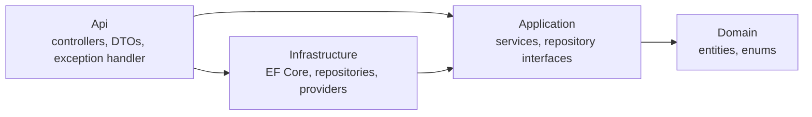
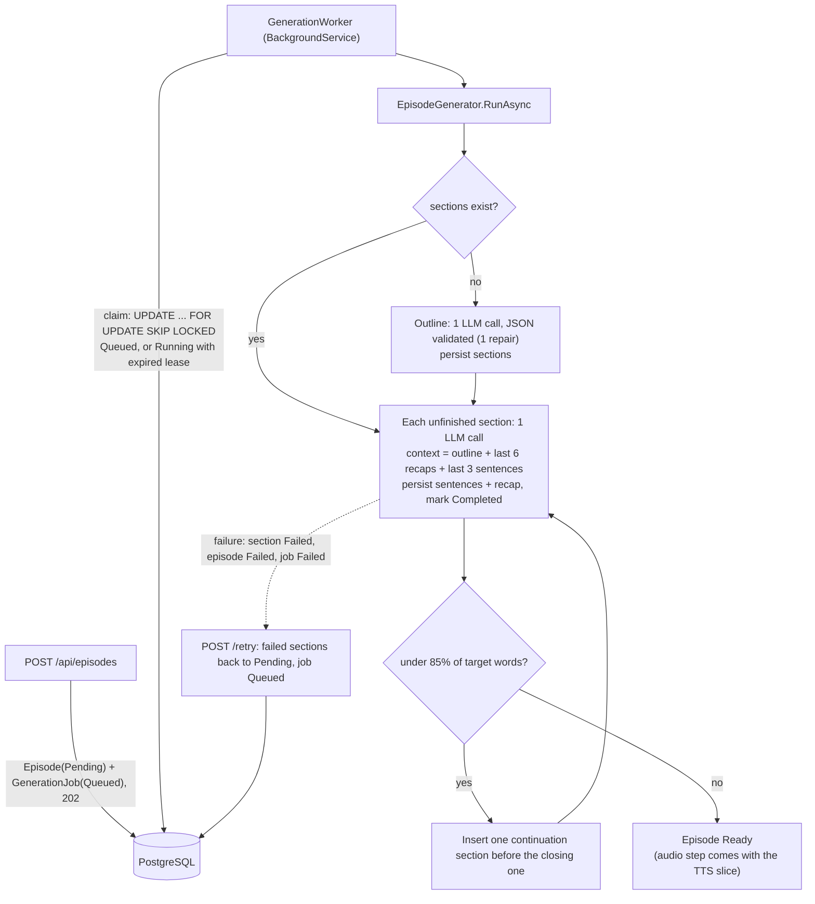
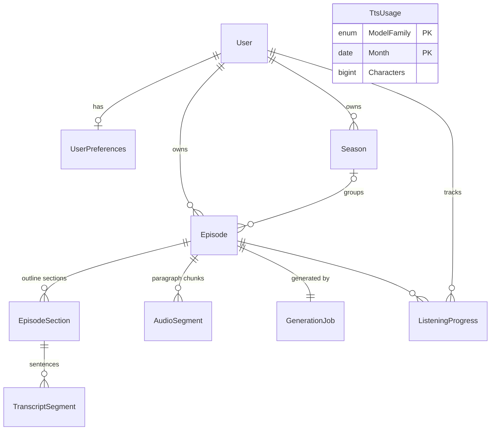

# Architecture

Decisions are in [DESIGN.md](DESIGN.md). This file explains how the code implements them and records the non-obvious choices.

## Layers

Controllers map entities to DTOs; entities never leave the API. Services throw `RequestValidationException` / `NotFoundException`, and `ConflictException`, which `AppExceptionHandler` turns into `ProblemDetails` (400 / 404 / 409). DataAnnotations on request DTOs catch malformed input; business rules (supported languages, configured duration range) live in services.

## Generation pipeline

- **Idempotent by construction.** `RunAsync` reloads the episode and only does what is missing. A section is saved and marked `Completed` in one `SaveChanges`, so a crash mid-call loses at most that call.
- **Leases.** A claimed job's `LockedUntil` is renewed every lease/3 while it runs. After a crash it expires and the next poll claims the job again. On graceful shutdown the worker hands the job back immediately.
- **Rolling context.** Each section call returns `{paragraphs, recap}`. The recap (English, 2–3 sentences) is the rolling summary for later sections, so there is no extra summarization call and the prompt size doesn't grow with episode length.
- **Length is measured.** Word counts come from the generated text. One continuation section is added if the episode is clearly short. It goes before the closing section so the goodbye stays last, and it is skipped for single-section episodes.
- **LLM errors.** 429 and 5xx responses are retried with `Retry-After` or exponential backoff with jitter, behind a requests-per-minute limiter. A `Retry-After` longer than `Llm:MaxDelaySeconds` (daily quota) fails the step at once with a clear message. Other 4xx responses fail without retry.

## Entities

- `TranscriptSegment` = one sentence, with `ParagraphIndex`. One paragraph = one `AudioSegment` (one TTS request), so sentence timings are derived from the paragraph's measured duration.
- `TtsUsage` is project-wide, not per user, because Google's free quota is per billing account.
- `Season` exists in the schema but has no API yet (post-MVP).

## Non-obvious choices
- **Enums are stored as strings** (`ConfigureConventions`). Reordering or adding enum values can't silently corrupt data, and rows are readable in `psql`.
- **Preferences are created lazily** on the first `GET`, with defaults from the entity. Only the user row is seeded (`SeedData.LocalUserId`), so default values have one source of truth.
- **Migrations run on startup only when `Database:MigrateOnStartup` is true** (Development and tests). Elsewhere they are a deploy step.
- **Local PostgreSQL listens on host port 5433**, not 5432, to avoid clashing with a Postgres already installed on the machine.
- **Integration tests get their own database** per test class (`podcast_test_<guid>`), created by migrations and dropped afterwards. CI points them at its service container through `ConnectionStrings__Default`.
- **DataAnnotations number limits parse in invariant culture.** Otherwise `[Range(typeof(decimal), "0.75", "2.0")]` throws on machines whose locale uses a comma as the decimal separator.
- **MSBuild warnings fail the build too** (`MSBuildTreatWarningsAsErrors`), so package version conflicts are caught early. EF Core Relational is pinned in Infrastructure for that reason.
- **New child rows get their keys from EF**, not `Guid.NewGuid()`. A child added through a navigation with a preset key on a store-generated column is treated as an existing row, and EF issues an UPDATE that affects 0 rows.
- **Text is cleaned before storage.** Markdown characters and short bracketed stage directions such as "(Musik)" are removed, because everything is read aloud. Sentence splitting knows common German abbreviations and ordinals ("am 3. Oktober"), but 3- and 4-digit years still end a sentence.
- **Infrastructure references the ASP.NET Core shared framework** (`FrameworkReference`) for HttpClientFactory and hosting, instead of separate NuGet packages.
