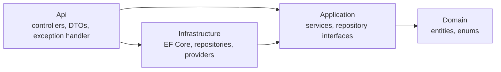
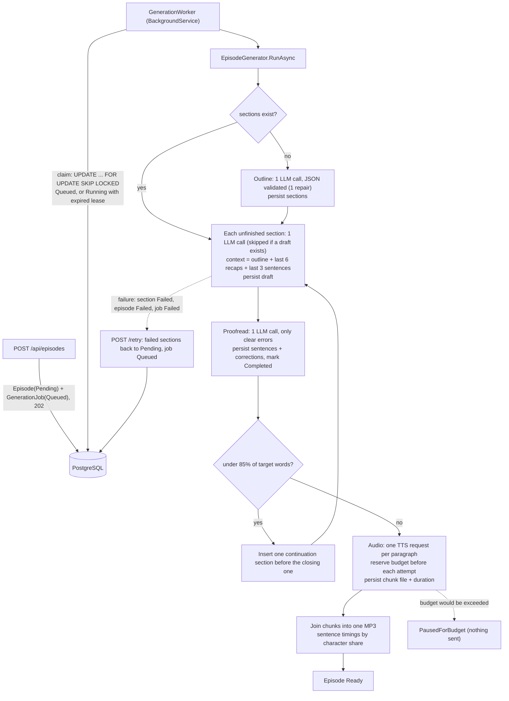
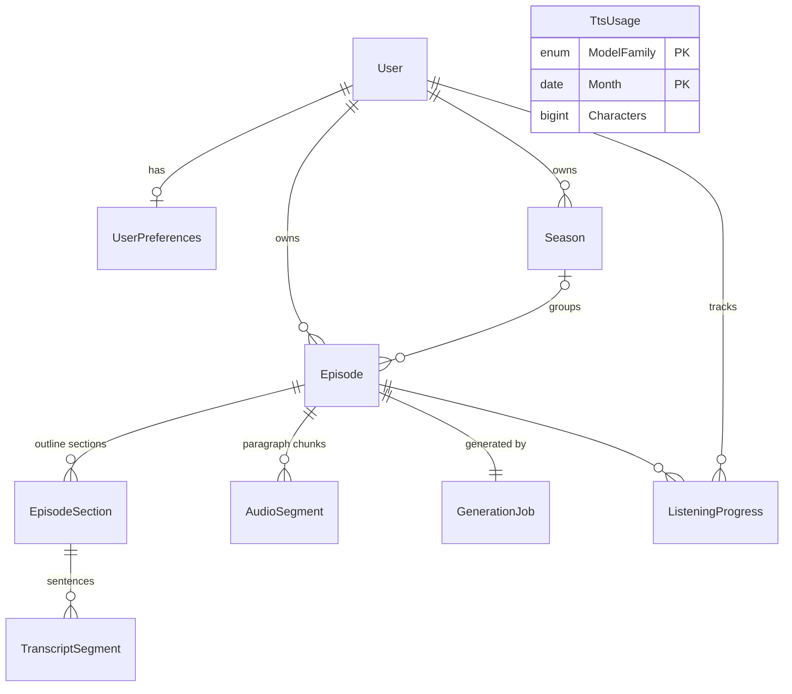

# Architecture

Decisions are in [DESIGN.md](DESIGN.md). This file explains how the code implements them and records the non-obvious choices.

## Layers

Controllers map entities to DTOs; entities never leave the API. Services throw `RequestValidationException` / `NotFoundException`, and `ConflictException`, which `AppExceptionHandler` turns into `ProblemDetails` (400 / 404 / 409). DataAnnotations on request DTOs catch malformed input; business rules (supported languages, configured duration range) live in services.

## Generation pipeline

- **Idempotent by construction.** `RunAsync` reloads the episode and only does what is missing. A section is saved and marked `Completed` in one `SaveChanges`, so a crash mid-call loses at most that call.
- **Leases.** A claimed job's `LockedUntil` is renewed every lease/3 while it runs. A failed renewal is logged and retried on the next tick. After a crash the lease expires and the next poll claims the job again. On graceful shutdown the worker hands the job back immediately. Every claim increments `Attempts`, and that number is the owner token: renewals, hand-backs and the final status update only apply while it still matches. A worker that lost its lease therefore stops and writes nothing, so two API instances never finish the same episode.
- **Proofreading.** Learners copy what they hear, so each section gets a second, low-temperature call that may only fix clear errors (gender, case, endings, spelling). The draft is saved before proofreading, so a proofreading failure never pays for the section text again. Replies that change the paragraph count or move any paragraph by more than 10% of its words are rejected (one repair, then the draft is kept and a warning logged, so an over-eager proofreader can't block an episode). The draft and the list of corrections stay in `EpisodeSection.DraftJson` / `CorrectionsJson` for auditing. On a real Gemini run it fixed exactly the two errors in a 526-word section and changed nothing else. Disable with `Episodes:Proofread=false`.
- **Audio chunks.** One TTS request per transcript paragraph (≤ 1,000 chars, well under Google's 5,000-byte request limit). Each `AudioSegment` has a cache key, `sha256(provider, model family, voice, speaking rate, text)`. Chunks with an unchanged key are never synthesized again, and a changed one is replaced. A finished chunk whose file has disappeared (storage moved or cleaned) goes back to Pending, so a retry can always finish. The resolved voice is stored on the episode at creation, so changing the configured default voice later doesn't invalidate finished audio.
- **Budget before every attempt.** The pipeline reserves the chunk's UTF-8 byte count in `TtsUsage` with one conditional `UPDATE ... WHERE Characters + n <= budget`, so concurrent reservations can't both pass. Only then is the request sent. The provider makes exactly one HTTP attempt per call; retries (transient 429/5xx/timeouts, up to 3 per run) happen in the pipeline and reserve again, so no request can bypass the budget. The family being charged is derived from the voice name, which is what Google bills by. Preferences must pair a voice with its own family, and the pipeline refuses a mismatched voice before reserving or sending anything. Budget months follow the provider's billing time zone (`Tts:BillingTimeZone`, Pacific time for Google), not UTC, so the counter doesn't reset hours before Google's does. A refused reservation pauses the episode (`PausedForBudget`), which is not a failure: retry once budget is available. Creating an episode whose estimate (`words × Tts:CharsPerWord`) doesn't fit the remaining budget is refused with 409 before any LLM call.
- **One stitched MP3.** Chunks are joined frame by frame by a small MPEG Layer III parser (`Mp3`), with no ffmpeg. ID3 tags and Xing/Info/VBRI header frames are dropped, otherwise players would take the first chunk's header as the length of the whole file. Durations come from counting frames. Sentence timings split each paragraph's measured duration by character share, which is close enough for highlighting and click-to-seek. One file keeps the player trivial: a single `<audio>` element with native seeking, speed and resume, served with HTTP Range support.
- **Auth by API key**, not a service account: plain REST with `X-Goog-Api-Key` (never in the URL, which ends up in logs) and no Google SDK or gRPC dependencies. The key should be restricted to the Text-to-Speech API.
- **Rolling context.** Each section call returns `{paragraphs, recap}`. The recap (English, 2–3 sentences) is the rolling summary for later sections, so there is no extra summarization call and the prompt size doesn't grow with episode length.
- **Length is measured.** Word counts come from the generated text. One continuation section is added if the episode is clearly short. It goes before the closing section so the goodbye stays last, and it is skipped for single-section episodes, which therefore only happen when two sections of 300 words don't fit (a 5-minute episode at the slowest speed).
- **LLM errors.** 429 responses are retried with `Retry-After` or exponential backoff with jitter, behind a requests-per-minute limiter. 5xx responses and network errors use a longer base backoff (`Llm:OverloadBaseDelayMs`), because overload lasts minutes. Timeouts are retried only `Llm:MaxTimeoutRetries` times (default 1), since a timed-out request may still be billed against the free quota. A `Retry-After` longer than `Llm:MaxDelaySeconds` (daily quota) stops retrying at once. When the main model is unavailable after all that, the call is repeated once on `Llm:FallbackModel`; overload and free quotas are per model. 4xx configuration errors (bad key, unknown model) fail immediately and never fall back.
- **Speaking speed and length.** Level picks the language, speaking speed picks the pace, and both feed the length. The first real episode came out at 8.3 instead of 10 minutes, because WaveNet reads ~160 words/min and the old per-level estimate assumed 125. Now each voice family has a measured pace (`Tts:Pace`), and `speakingRate` scales it. WaveNet durations scale exactly with the rate (0.85× → 1.17× longer). Chirp 3: HD only scales by about two thirds as much (0.75× → 1.21× longer), so its pace has an exponent of 0.66. Speed is resolved once at creation (request, then preferences, then level default) and stored on the episode, so a retry voices the rest at the same speed. It is part of each chunk's cache key.
- **Length prompting.** Measured on Gemini, asking for "about N words" produced ~70% of N. Section prompts (`section.v2`) ask for a minimum word count *and* a paragraph count of ~100 words each, which brought sections to ~85–95%.
- **Calibrated section sizes** (2026-11-16, from every section written so far):
  - Sections of 600–900 words came out at 80–103% of the ask, about 91% on average (18 sections). These now ask for their share ÷ 0.91 (`Episodes:WrittenShare`), which brought a 10-minute episode to 9:57.
  - Sections of 300–390 words came out at 89–115% (9 sections), so asks under 500 words (`Episodes:WrittenShareFromWords`) are left alone. Inflating them overshot to 117%.
  - One 680-word section varied between 67% and 97% of the ask. Since a single section greets and says goodbye, it could never be topped up, and 5-minute episodes ran 3:46–4:48. So episodes with room for two sections of 300+ words (`Episodes:ShortSectionMinWords`) always get two. 5-minute episodes then came out at 4:44 and 5:09.

## Seasons
- **The arc is planned inside episode 1's job.** `POST /api/seasons` saves the season and queues episode 1, nothing more, because LLM work never runs inside a request. The job sees a season without an arc, plans it (one `season-arc.v1` call, validated to exactly N parts, one repair), saves it, renames episode 1 after part 1, and only then writes the outline. If planning fails, episode 1 fails and **Retry** plans again.
- **Each episode builds on the earlier ones.** `PromptBuilder.SeasonContext` adds the whole arc, the summaries of the 3 most recent earlier episodes (older ones are covered by the arc lines, which keeps the prompt bounded) and "plan only episode n" to the outline prompt (`outline.v2`). The first section names the part and recalls the last one, and the last section teases the next part or wraps up the series.
- **One episode at a time, in order.** `POST /api/seasons/{id}/episodes` refuses (409) until the latest episode is Ready, because its summary is the next one's context. That also spreads the TTS cost over time, and the budget check runs for every episode. Every episode uses the season's settings.
- **The order has no gaps.** Only the latest season episode can be deleted on its own (then it can be made again); deleting the season deletes all of its episodes and their audio.
- Measured on a real run (2026-11-15, three 5-minute B1 parts on the Hanseatic League): the arc came out in a sensible order, and part 2 opened with "Heute hörst du den zweiten Teil unserer Reihe … Im ersten Teil haben wir gelernt …" and ended by teasing part 3.

## Vocabulary
- **Saving** (`POST /api/vocabulary` with a sentence id and the selected text) checks that the text really occurs in that sentence and is at most 6 words, before any LLM call: the selection goes into a prompt. One interactive LLM request (`vocab-card.v1`, the fast model) returns the dictionary form and the meaning in context. A card whose dictionary form the user already has (case-insensitive) is returned instead of duplicated (200 rather than 201).
- **Context survives.** The sentence is copied into the card, and the links to the episode and sentence are `SET NULL` on delete, so words outlive their episode. While the episode exists, cards carry the sentence's start time for "Hear it" (`/episodes/{id}?t=…`, rounded up to the next tenth so it lands on the sentence, not the end of the one before).
- **Scheduling** is Leitner boxes (`ReviewSchedule`): "Got it" moves a card up one box (gaps of 1, 3, 7, 14, 30, 60 days), "Again" sends it to box 0, due in 10 minutes. New cards are due at once. Predictable and enough for a few new words per episode; SM-2-style ease factors would be the next step.
- **Selecting in the read-along** shows a floating Save button over the selection when it lies within one sentence. A click that ends a selection doesn't seek or translate, and the button keeps the selection alive (mousedown is prevented). The note is kept inside the window near the edges.

## Sentence translation
- **One request per paragraph.** Clicking a sentence translates its whole paragraph: the model gets context (pronouns, ellipsis), and the other sentences of the paragraph are then free. Replies must have exactly one non-empty translation per sentence (one repair, like every LLM JSON reply).
- **Cached per language.** Each sentence stores its translation and the language it's in. Asking again is answered from the database; changing the native language in preferences translates again on the next click.
- **Interactive LLM requests.** A translation has a person waiting, so it is marked `Interactive`. It uses `Llm:InteractiveModel` (a small fast model), a 20-second limit per attempt, one retry and at most a 2-second pause. Background generation keeps the main model and its minutes-long backoff. Measured on 2026-11-14: the main model answered 503 after 39 s while the lite model answered in 1.8 s. When the model is busy anyway, the API answers 503 with a plain message; provider details stay in the logs (`LlmUnavailableException` → 503, other `LlmException` → 502).
- **In the web app,** a "Click a sentence to: Play from there / Translate" switch (remembered in local storage) decides what a click does. Opened translations appear under their paragraph in the UI font with the sentence underlined; clicking the sentence again hides it.

## Accounts and sign-in
- **Two tokens.** The **access token** is a JWT whose only claim is the user id (`sub`), valid for 15 minutes (`Auth:Jwt:AccessTokenMinutes`). It is verified by signature alone, with no database lookup per request, which is the point of using a JWT. The **refresh token** is 32 random bytes; only its SHA-256 is stored (`RefreshTokens`). It lasts 30 days from its last use (`Auth:Sessions:RefreshTokenDays`) and can be revoked, which a JWT can't.
- **Where they live.** Both are HttpOnly, SameSite=Strict cookies. The access token goes to all of `/api`; the refresh token only to `/api/auth`, so the long-lived token isn't attached to every request. `Secure` follows the request, because local development runs on plain http. Cookies were chosen over tokens held by JavaScript for two reasons: the browser's `<audio>` element can only authenticate with cookies, and an HttpOnly cookie can't be read by an injected script. SameSite=Strict is the CSRF protection: other sites can't make the browser send them.
- **Rotation and theft detection.** `POST /api/auth/refresh` marks the presented token used (one conditional `UPDATE`) and issues a new one in the same *family* (one sign-in on one device). If a token is presented again after it was used, a copy is in circulation: the whole family is revoked, so the thief and the owner are both signed out of that sign-in. A second use within 30 seconds (`Auth:Sessions:ReuseGraceSeconds`) is treated as two tabs refreshing at once and only gets a new access token.
- **The trade-off, stated.** Revocation reaches other devices when their access token expires, so within 15 minutes, not instantly. An earlier draft checked a per-user session version on every request, which made sign-out instant but turned the JWT back into a looked-up session. With one API and one database that would have been cheap, but it gives up what a JWT is for.
- **In the web app,** `refreshSession()` renews the access token every 10 minutes while signed in, when a sleeping tab becomes visible, and after any 401 (then retries the request once). Concurrent callers share one refresh request, so a burst of 401s doesn't use the refresh token several times. Renewing ahead of time matters for audio: the `<audio>` element can't retry a 401 itself.
- **Secure by default.** A fallback authorization policy requires a signed-in user on every endpoint. Only registration, register, login, refresh, logout and `/health` opt out with `[AllowAnonymous]`, so a new endpoint can't be left open by accident.
- **Who is asking.** `HttpCurrentUser` reads `sub` from the validated token; services keep filtering every query by that id, so another account's episode is a 404, not a 403 (its existence isn't revealed).
- **Sign-in gives nothing away.** An unknown email and a wrong password produce the same 401 and the same message, and the unknown-email path still verifies one password hash so timing doesn't differ. Attempts are rate limited per address (ASP.NET Core's built-in limiter).
- **Behind a proxy** (`Proxy:TrustForwardedHeaders`, on in the server image), `X-Forwarded-For` and `X-Forwarded-Proto` from Caddy become the request's client address and scheme. Without that, every request would come from Caddy over plain HTTP: all users would share one sign-in rate limit, and cookies would lose `Secure`. Only the last hop is trusted (`ForwardLimit = 1`), and Caddy replaces whatever a client sent itself, so a client can't pick its own address. It's safe only because the API port is reachable by Caddy alone.
- **Invite-only sign-up.** With `Auth:Registration:InviteCode` set, registering needs that code (compared in fixed time). Every account can create episodes, which spends the shared LLM and TTS quotas, so the public server sets it. `GET /api/auth/registration` tells the form whether to ask for the code, without revealing it.
- **Passwords** are hashed by ASP.NET Core Identity's `PasswordHasher` (PBKDF2 with a per-password salt), used on its own behind `IPasswordHasher`; a hash made with outdated settings is replaced at the next sign-in. Rules follow NIST 800-63B: length (8–128), no composition rules.
- **Signing key.** `Auth:Jwt:SigningKey` must be at least 32 bytes; startup fails without it, except in Development, where a temporary key is generated and a warning logged.
- **The first account claims the local user.** Before accounts, everything belonged to one seeded user. The first registration takes that row over with one conditional `UPDATE ... WHERE Email IS NULL`, so existing episodes are kept and two simultaneous first registrations can't both get it.
- **In the web app,** `AuthGate` asks `GET /api/auth/me` on load and shows either the app or the sign-in screen. Any later 401 (the session ran out) fires an event that brings the sign-in screen back. The signed-in part of the app, including the audio player, unmounts on sign-out.
- **Change password** (`PUT /api/auth/password`) needs the current password, revokes every refresh token of the user, and starts a new sign-in for this device. Other devices are out once their access token expires.
- **Delete account** (`DELETE /api/auth/account`) needs the password and is refused while an episode is being generated. It collects the account's audio keys, deletes the user row (the database cascades to refresh tokens, preferences, seasons, episodes and listening progress), then deletes the files and the cookies. Another tab's access token still verifies for up to 15 minutes, but it finds nothing: lists are empty, owned items are 404, and the first write that needs the user row (creating default preferences) answers 401 (`AccountGoneException`).
- A wrong password in these two requests is a 400 field error, not 401: the user is signed in, and 401 would send the web app to the sign-in screen.
- **Not done yet:** email verification, password reset by email (it needs an email provider), cleaning out expired refresh-token rows.

## Deployment
One server runs everything with Docker Compose (`deploy/`); [DEPLOYMENT.md](DEPLOYMENT.md) is the step-by-step guide.
- **Containers:** `db` (PostgreSQL 17), `migrate` (the deploy step above), `api` (the API with its worker, as the image's non-root user) and `web` (Caddy with the built web app inside). Only `web` publishes ports.
- **Caddy** gets and renews the HTTPS certificate, serves the web app (hashed assets cached for a year, the page never), sends `/api/*` to the API, and adds security headers, including a CSP that allows only the site itself. Site and API share one origin, which the SameSite=Strict cookies need.
- **Data** lives in volumes: `pgdata`, `audio` (mounted at `/data/audio`) and `caddy_data` (the certificate). `deploy/backup.sh` dumps the database and archives the audio nightly; the restore is tested.
- **Images** are built for ARM by GitHub Actions on every merge to main (`.github/workflows/images.yml`) and published to GHCR. The API image cross-compiles from the build machine's architecture, so it builds on any machine.

## Frontend
`web/` is React + TypeScript + Vite, with React Router and plain `fetch`. There's no state library, UI kit or icon package.
- `api/client.ts` is the only place that calls the API. It turns `ProblemDetails` into an `ApiError`, whose `fieldErrors` use the form's camelCase names, so validation messages show next to the right field.
- `useApi` loads data for a screen and cancels the previous request when inputs change. Every screen has loading, empty and error states.
- **Persistent player.** `PlayerProvider` owns the app's only `<audio>` element, above the router, so playback continues across pages and the mini-player can control it. It saves the resume position every 5 s while playing, on pause, at the end, and when the tab is hidden (with a `keepalive` request so it survives closing the tab).
- **Season autoplay.** When a season episode ends, the player asks for the season and offers the next part: an 8-second countdown with Play now / Cancel, or, if the next part isn't Ready, a note linking to the season page. The next part starts from its saved position. The bar sits inside the router, so it can move the page along when the listener was on the finished episode's page. The player's `load`/`save` read the current episode from a ref and never change identity: when they did, the page still showing the finished episode re-ran its "load my episode" effect and switched the player back, saving 0:00 over the next part's position (found in the browser check).
- **Read-along.** Transcript sentences are inline spans with `role="button"`, not `<button>`s, because buttons render inline-block and would break the paragraph flow. A binary search over sentence start times finds the current sentence, and it's scrolled into view unless the listener turns that off.
- **Generation progress.** The episode page polls `/status` every 2.5 s while the episode is being made, and switches to the player when it's Ready.
- **Library filters live in the URL,** so reloads and back/forward keep them.
- **Design.** It's styled as a quiet device: warm-grey housing, ink, and one green signal colour. The transcript is the one loud element, in a book serif (Charter) with a highlighter-yellow current sentence. It uses system fonts only, so the app makes no third-party requests. Dark mode follows the system.

## Entities

- `TranscriptSegment` = one sentence, with `ParagraphIndex`. One paragraph = one `AudioSegment` (one TTS request), so sentence timings are derived from the paragraph's measured duration.
- `TtsUsage` is project-wide, not per user, because Google's free quota is per billing account.
- A `Season` owns its episodes (`SeasonId`, `SeasonOrder` from 1). The episode delete cascade from a season is `SetNull` in the schema, but deleting a season removes its episodes explicitly.

## Non-obvious choices
- **Enums are stored as strings** (`ConfigureConventions`). Reordering or adding enum values can't silently corrupt data, and rows are readable in `psql`.
- **Preferences are created lazily** on the first `GET`, with defaults from the entity. Only the user row is seeded (`SeedData.LocalUserId`), so default values have one source of truth.
- **Migrations run on startup only when `Database:MigrateOnStartup` is true** (Development and tests). On the server they are a deploy step: the same API image started with `--migrate-only` applies them and exits, and Compose starts the API only after that succeeded. One image, no separate EF tool, and two API instances can never race to migrate.
- **Local PostgreSQL listens on host port 5433**, not 5432, to avoid clashing with a Postgres already installed on the machine.
- **Integration tests get their own database** per test class (`podcast_test_<guid>`), created by migrations and dropped afterwards. CI points them at its service container through `ConnectionStrings__Default`.
- **DataAnnotations number limits parse in invariant culture.** Otherwise `[Range(typeof(decimal), "0.75", "2.0")]` throws on machines whose locale uses a comma as the decimal separator.
- **MSBuild warnings fail the build too** (`MSBuildTreatWarningsAsErrors`), so package version conflicts are caught early. EF Core Relational is pinned in Infrastructure for that reason.
- **New child rows get their keys from EF**, not `Guid.NewGuid()`. A child added through a navigation with a preset key on a store-generated column is treated as an existing row, and EF issues an UPDATE that affects 0 rows.
- **Text is cleaned before storage.** Control characters are stripped from everything the LLM returns, because PostgreSQL rejects `\u0000` in text and jsonb. Markdown characters and short bracketed stage directions such as "(Musik)" are removed, because everything is read aloud. Sentence splitting knows common German abbreviations and ordinals ("am 3. Oktober"), but 3- and 4-digit years still end a sentence.
- **Library search matches text literally.** `%`, `_` and `\` in the search box are escaped before the case-insensitive `ILIKE`, so they don't act as wildcards. Each item carries the user's listening progress, read in the same query.
- **Listening progress is clamped to the audio length,** because players report positions slightly past the end. It can only be saved for Ready episodes.
- **Infrastructure references the ASP.NET Core shared framework** (`FrameworkReference`) for HttpClientFactory and hosting, instead of separate NuGet packages.
