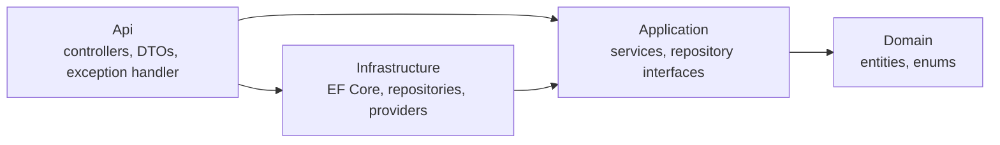
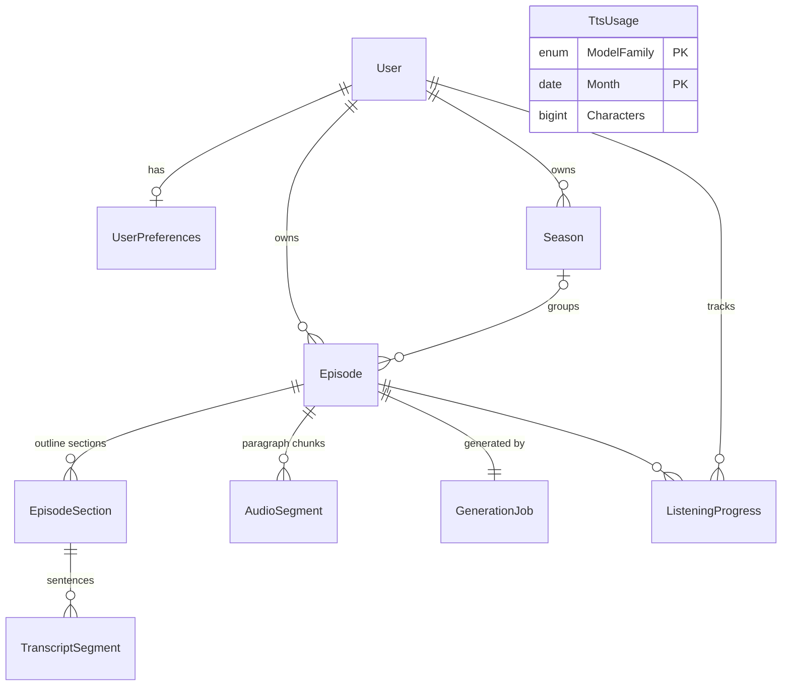

# Architecture

Decisions are in [DESIGN.md](DESIGN.md). This file explains how the code implements them and records the non-obvious choices. The pipeline diagram arrives with the generation slice.

## Layers

Controllers map entities to DTOs; entities never leave the API. Services throw `RequestValidationException` / `NotFoundException`, which `AppExceptionHandler` turns into `ProblemDetails` (400 / 404). DataAnnotations on request DTOs catch malformed input; business rules (supported languages, configured duration range) live in services.

## Entities

- `TranscriptSegment` = one sentence, with `ParagraphIndex`. One paragraph = one `AudioSegment` (one TTS request), so sentence timings are derived from the paragraph's measured duration.
- `TtsUsage` is project-wide, not per user, because Google's free quota is per billing account.
- `Season` exists in the schema but has no API yet (post-MVP).

## Non-obvious choices
- **Enums are stored as strings** (`ConfigureConventions`). Reordering or adding enum values can't silently corrupt data, and rows are readable in `psql`.
- **Preferences are created lazily** on the first `GET`, with defaults from the entity. Only the user row is seeded (`SeedData.LocalUserId`), so default values have one source of truth.
- **Migrations run on startup only when `Database:MigrateOnStartup` is true** (Development and tests). Elsewhere they are a deploy step.
- **Local PostgreSQL listens on host port 5433**, not 5432, to avoid clashing with a Postgres already installed on the machine.
- **Integration tests get their own database** per test class (`podcast_test_<guid>`), created by migrations and dropped afterwards. CI points them at its service container through `ConnectionStrings__Default`.
- **DataAnnotations number limits parse in invariant culture.** Otherwise `[Range(typeof(decimal), "0.75", "2.0")]` throws on machines whose locale uses a comma as the decimal separator.
- **MSBuild warnings fail the build too** (`MSBuildTreatWarningsAsErrors`), so package version conflicts are caught early. EF Core Relational is pinned in Infrastructure for that reason.
